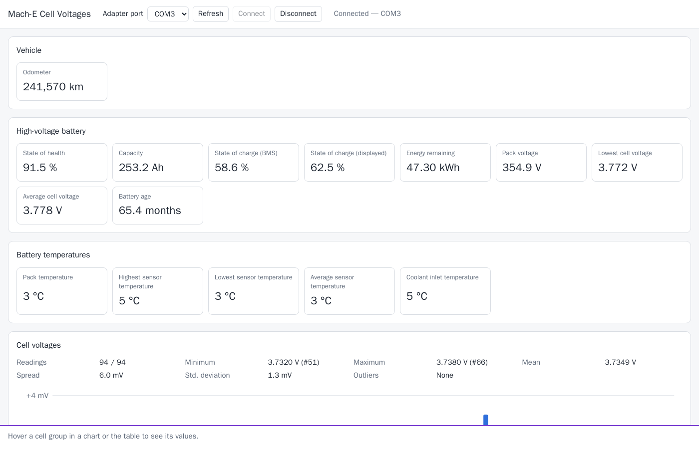
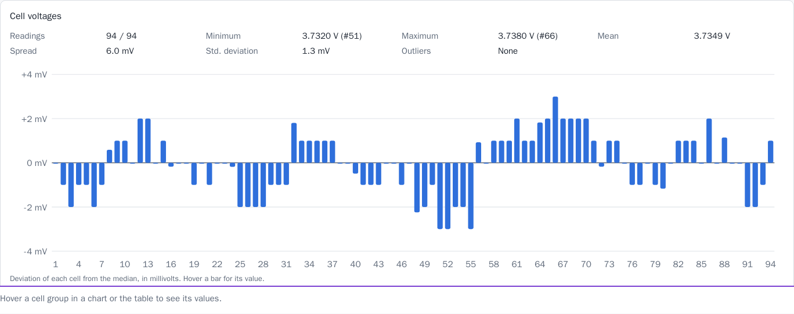
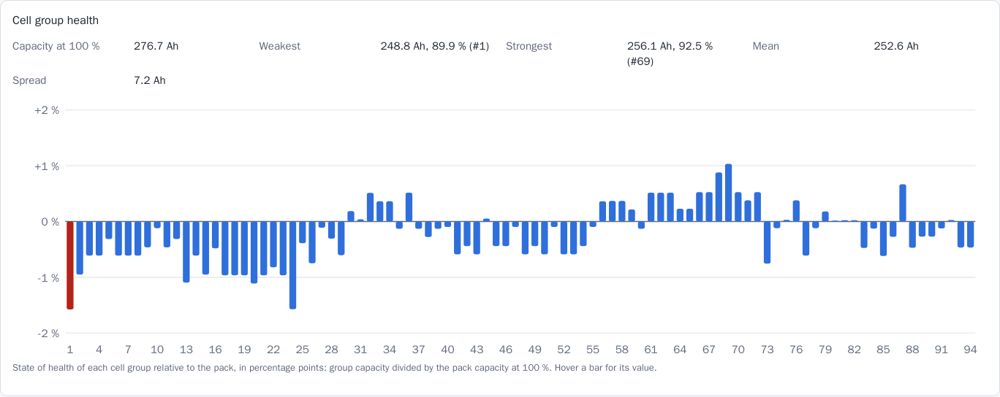
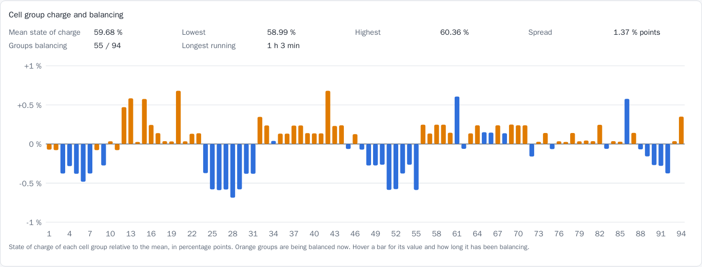

# Mach-E Battery Cell Voltage Reader

Reads every cell voltage of a Ford Mustang Mach-E high-voltage battery, together with state of health and
other battery values, through an ELM327-compatible OBD adapter. Shows them in a browser or prints them on
the command line.









## How it works

The battery energy control module (request `0x7E4`, response `0x7EC`) answers UDS `0x22`
ReadDataByIdentifier requests. Each cell value is one big-endian IEEE 754 float per series cell group:

| Identifier | Content |
|---|---|
| `0xFDF4` | Cell group voltages (first of three runs of floats). Layout: [docs/cell-block.md](docs/cell-block.md) |
| `0xFDCD` | Capacity of each cell group, Ah |
| `0xFDCE` | State of charge of each cell group, % |
| `0xFDEB` | Balancing active, one byte per cell group |
| `0xFDD3` | Time each cell group has been balancing, 32-bit count of 0.2 s |

The program only sends UDS `0x22` ReadDataByIdentifier requests.

## Values shown

- **Cell voltages:** every cell group, with minimum, maximum, mean, spread, standard deviation, outliers, a
  deviation chart and a table.
- **Cell group health:** capacity of each group and its state of health against the pack capacity at
  100 % (pack capacity divided by pack state of health), weakest and strongest group.
- **Cell group charge and balancing:** state of charge of each group relative to the mean, which groups
  are being balanced and for how long.
- **Battery:** state of health, capacity, state of charge (BMS and displayed), energy remaining, pack
  voltage, lowest and average cell voltage, battery age.
- **Temperatures:** pack, highest, lowest and average sensor, coolant inlet.
- **Odometer.**

Verified on a 2021 Mach-E extended range (94 cell groups in series) with an OBDLink STN2231 adapter.

## Disclaimer

Ford does not publish these identifiers. The cell-level values were decoded by reverse engineering on one
vehicle:

- every identifier the battery energy control module answers was read and decoded as integers and floats;
- candidate values were compared with the module's own published pack values: the cell group voltages sum
  to the pack voltage and match its lowest and average cell voltage, and the mean group capacity matches
  the pack capacity;
- readings were repeated at different states of charge and temperatures to separate live values from
  stored ones: group capacities stayed unchanged, group charge changed with the pack state of charge, and the
  balancing flags and timers agree group for group, with timers advancing at five counts per second.

The module refreshes the cell group voltages and charge only every few minutes, so they can lag the pack
values. The meaning of each value is an interpretation of this data, not a documented definition. Values may be
wrong or differ on other vehicles, battery versions and software levels. Use them for information only,
not for repair or safety decisions. The project is not affiliated with or endorsed by Ford Motor Company.

## Windows

1. Download `MacheCellVoltageReader-<version>-setup.exe` from the latest
   [GitHub release](../../releases/latest) and run it. No Python or other software is needed.
2. Plug the OBD adapter into the car's OBD port and switch the car on. Connect the adapter to the computer
   with USB, or pair a Bluetooth adapter in Windows first.
3. Start **Mach-E Cell Voltage Reader** from the Start menu. A console window opens and your browser shows
   the reader at `http://127.0.0.1:8080/`. Only this computer can reach it.
4. Select the adapter's COM port and press **Connect**. The port is listed in Windows Device Manager under
   *Ports (COM & LPT)*.
5. To stop the reader, close the console window. Starting it again while it runs only opens the browser.

Uninstall under *Settings > Apps*. The settings in the Configuration section work as Windows environment
variables, for example `MACHE_PORT` for another port.

Build the installer on a Windows machine with Python 3.13, Node.js and Inno Setup 6:

```powershell
./packaging/build.ps1
```

The result is `packaging/build/installer/MacheCellVoltageReader-<version>-setup.exe`. The version is read
from `pyproject.toml`. Pushing a tag `v*` builds the installer in GitHub Actions and attaches it to a release.

## Run

Requires Docker with Compose and an ELM327-compatible adapter (CAN 11-bit, 500 kbit/s) on the OBD port,
with the car switched on.

```sh
cp .env.example .env
docker compose up -d --build app
```

Open `http://localhost:8080`, select the adapter port and press **Connect**.

Single reading on the command line:

```sh
docker compose run --rm app mache-cells read /dev/ttyUSB0
docker compose run --rm app mache-cells read /dev/ttyUSB0 --json
```

## Configuration

| Variable | Default | Purpose |
|---|---|---|
| `MACHE_BIND_ADDRESS` | `127.0.0.1` | Host address the GUI is published on |
| `MACHE_PUBLISH_PORT` | `8080` | Host port of the GUI |
| `MACHE_READ_INTERVAL_S` | `2.0` | Minimum seconds between readings |
| `MACHE_BAUDRATE` | `115200` | Serial speed to the adapter |
| `MACHE_COMMAND_TIMEOUT_S` | `2.0` | Silence after which the adapter is considered unresponsive |
| `MACHE_RESET_TIMEOUT_S` | `5.0` | Adapter reset timeout |
| `MACHE_SEPARATION_MS` | `5` | Separation time (0–127 ms) between frames of the cell reply |
| `MACHE_FRAME_TIMEOUT_MS` | `200` | Adapter wait per frame, above the separation time (at most 1020) |
| `MACHE_OUTLIER_DEVIATION_V` | `0.02` | Deviation from the median that flags a cell |
| `MACHE_SPREAD_WARNING_V` | `0.05` | Spread that is flagged |
| `MACHE_PORT_PATTERNS` | `/dev/ttyUSB*,/dev/ttyACM*,/dev/rfcomm*` (Windows: `COM*`) | Device globs offered as ports |
| `MACHE_HOST` | `0.0.0.0` (Windows application: `127.0.0.1`) | Address the GUI listens on |
| `MACHE_PORT` | `8080` | Port the GUI listens on |

On a Bluetooth or USB-over-network link, use `MACHE_SEPARATION_MS=20` and `MACHE_FRAME_TIMEOUT_MS=60`.

## Development

The GUI is a Vue 3 + Vite + TypeScript app in `frontend/`. It receives every reading and connection change
over the WebSocket `/api/events` and reconnects automatically. Node and npm run only in Docker.

```sh
docker compose run --rm --build checks            # ruff, mypy --strict, pytest
docker compose run --rm --build frontend-checks   # eslint, stylelint, vue-tsc, vitest, vite build
docker compose run --rm --build screenshot        # README images from a running, connected GUI
```

Build an installable wheel that includes the built GUI (written to `dist/`):

```sh
docker compose run --rm --build wheel
```

`pip wheel` outside this service produces a wheel without the GUI, because the frontend is built in the
Docker image.
